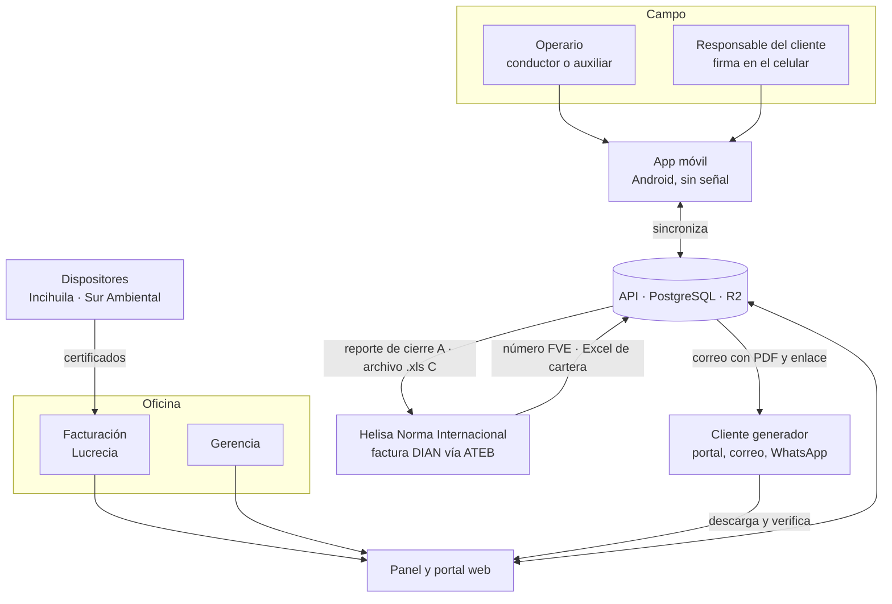
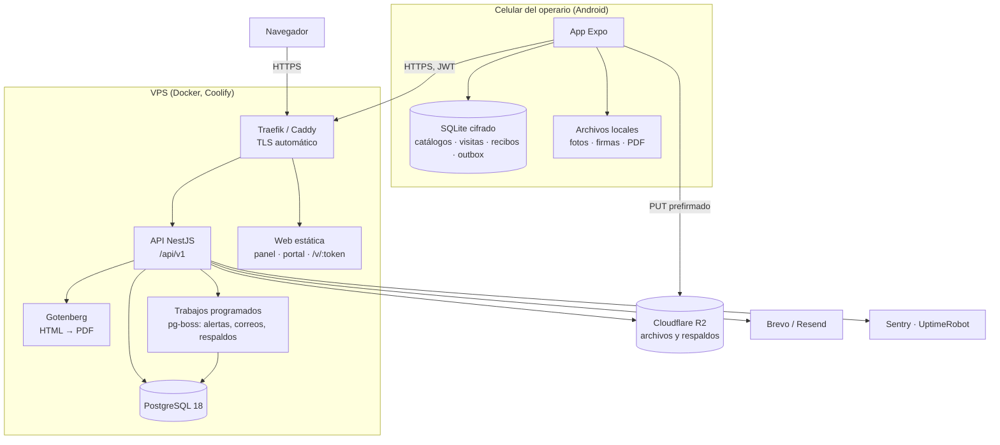
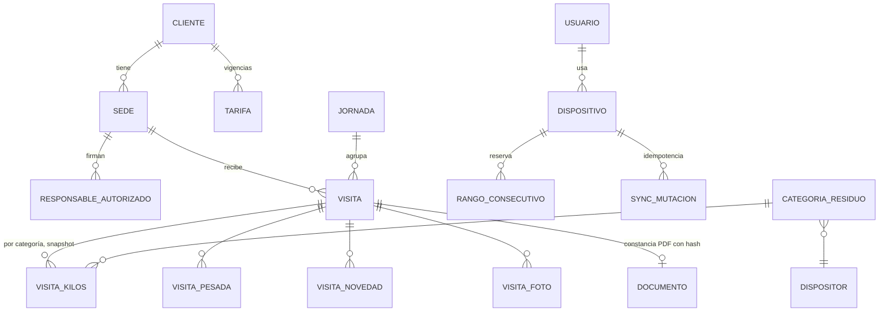
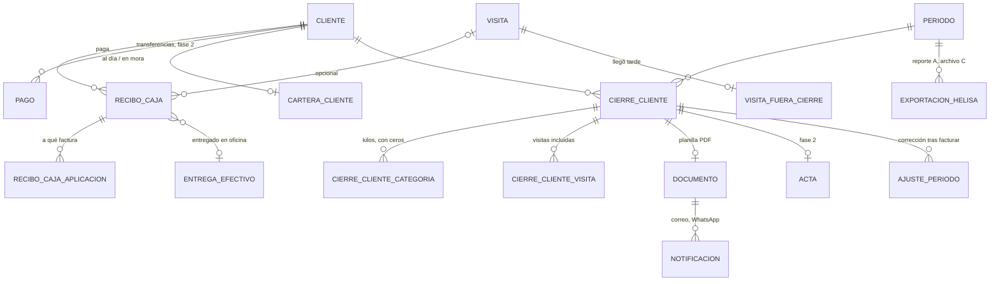
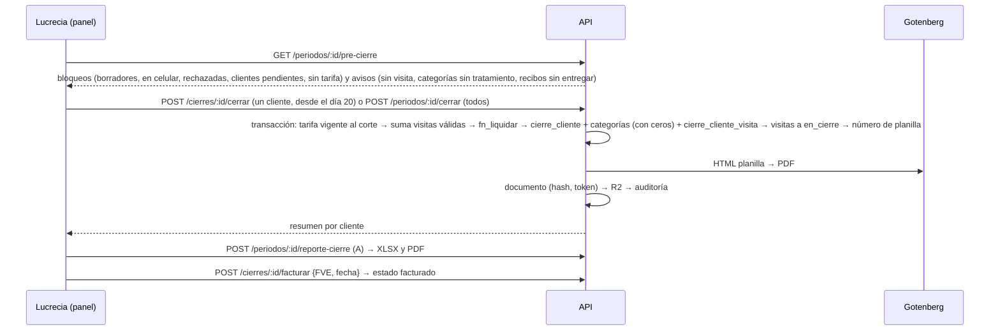
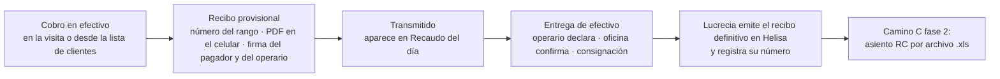
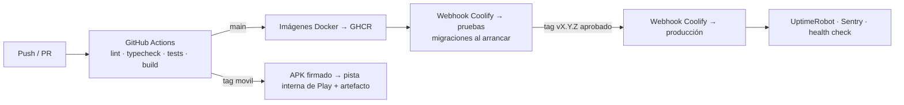

# Arquitectura técnica · RH digital Comserva

**Versión 1.0 · 18 de octubre de 2026 · Equipo de desarrollo (Adrián, Hernando y equipo)**

Este documento dice cómo se construye el sistema que describe el *Levantamiento de requerimientos v4*: qué piezas tiene, con qué tecnología, cómo se guardan y mueven los datos, cómo se despliega y cómo se opera. Está escrito para que el equipo pueda empezar a programar la fase 1 mañana con Claude Code y para que cualquier desarrollador nuevo entienda el sistema en una tarde. El modelo de datos completo está en [`schema.sql`](schema.sql).

---

## 1. Resumen en una página

| Pieza | Qué es | Tecnología elegida | Fase |
| --- | --- | --- | --- |
| **App del operario** | Registra la visita (kilos, firmas, fotos, GPS), la visita fallida o sin residuos, el recibo de caja y la jornada. Funciona sin señal. | Expo SDK 58 (React Native 0.88) + TypeScript, SQLite cifrado (expo-sqlite + SQLCipher), cola de envío propia, PDF local con expo-print | 1 |
| **API** | Única puerta de entrada a los datos. Autenticación, reglas de negocio, sincronización idempotente, cierre del periodo, generación de documentos, salida hacia Helisa. | Node 24 LTS + NestJS + Drizzle ORM + Zod, PostgreSQL 18 | 1 |
| **Panel de oficina** | Clientes, sedes y tarifas; catálogos y parámetros; bandeja de visitas; recaudo; cierre del periodo; reporte para Helisa; usuarios y auditoría. | React 19 + Vite + TypeScript, TanStack Query/Router, Tailwind + shadcn/ui | 1 |
| **Portal del cliente** | El cliente descarga constancias, planillas, recibos y actas; el acta solo si está al día. Página pública de verificación por QR. | Misma aplicación web con rol *cliente*; la verificación es una ruta pública | Verificación: 1 · Portal: 2 |
| **Generador de PDF** | Planilla mensual, acta, reporte de cierre (servidor). Constancia y recibo (celular, una sola vez). | Gotenberg (Chromium) con plantillas HTML; en el celular, expo-print con las mismas plantillas | 1 |
| **Almacén de archivos** | PDF, firmas (PNG), fotos, comprobantes, archivos de importación y exportación. | Cloudflare R2 (S3 compatible), URL prefirmadas | 1 |
| **Mensajería** | Correo con el PDF y enlace de consulta (servidor). WhatsApp desde el celular (fase 1) y por API (fase 3). | Brevo o Resend (correo); Meta Cloud API directa (fase 3) | 1 / 3 |
| **Salida hacia Helisa** | Camino A: reporte de cierre en el orden de la pantalla de ventas de Helisa. Camino C: archivo `.xls` de movimiento contable (recibos de caja) y cartilla de terceros. | SheetJS CE (BIFF8) | A: 1 · C: 2 |
| **Infraestructura** | Un VPS con Docker gestionado por Coolify, Postgres en contenedor con copias a R2, dominio propio, TLS automático, monitoreo gratuito. | Hostinger KVM 2 (8 GB) o DigitalOcean 4 GB; Coolify; Cloudflare DNS; UptimeRobot; Sentry | 1 |

**Principios que gobiernan todas las decisiones**

1. **La visita es la única captura.** Planilla, acta, valor de la factura y reportes se derivan de ella. Nunca se digita un total.
2. **Lo firmado no se edita.** Se anula con motivo y se emite otro documento. La base de datos lo impide con triggers, no solo la interfaz.
3. **Cada documento guarda el mundo tal como estaba ese día.** Nombres de categoría, tratamiento, dispositor, razón social, tarifa y textos legales se copian en el registro (snapshot). Un cambio de catálogo nunca altera un PDF ya emitido.
4. **Sin señal es un caso normal, no una excepción.** Identificadores creados en el celular (UUID v7), rangos de consecutivos reservados por dispositivo, cola de envío con idempotencia.
5. **Un solo archivo oficial por documento.** La constancia y el recibo se generan una vez en el celular y se suben con su hash; el servidor nunca los regenera. Planilla, acta y reportes se generan solo en el servidor.
6. **Todo parámetro de negocio vive en la base de datos** (día de corte, IVA, tamaño de rango, textos legales), editable desde el panel y auditado.
7. **TypeScript de punta a punta.** Un solo lenguaje, esquemas Zod compartidos entre app, API y panel, y las mismas plantillas HTML para los PDF del celular y del servidor. Es la configuración en la que tres personas con Claude Code rinden más.

---

## 2. Contexto: actores y sistemas externos



El sistema **no** habla con la DIAN: la factura electrónica nace en Helisa (módulo Gestión Ventas, proveedor tecnológico ATEB Colombia, filial de Proasistemas) y seguirá naciendo allí. Lo que el sistema produce es el dato exacto que Lucrecia necesita para emitirla sin sumar nada, y el registro del número de factura que ella devuelve.

---

## 3. Decisiones de tecnología y por qué

### 3.1 App móvil: Expo (React Native) con TypeScript

| Criterio | Expo SDK 58 (elegido) | Flutter 3.47 (alternativa válida) | PWA |
| --- | --- | --- | --- |
| Un solo lenguaje con API y panel | Sí (TypeScript, Zod compartido) | No (Dart + TypeScript) | Sí |
| Firma en pantalla | `react-native-signature-canvas` (WebView, exporta PNG) o `@shopify/react-native-skia` (nativo) | `signature` nativo | Canvas |
| Base local cifrada | `expo-sqlite` con `useSQLCipher` (requiere *development build*, no Expo Go) | `drift` + SQLite3MultipleCiphers (sin paquetes extra) | IndexedDB sin cifrado garantizado |
| PDF sin señal | `expo-print` renderiza **las mismas plantillas HTML** del servidor | paquete `pdf` (otro motor de diseño) | No fiable |
| Compartir por WhatsApp | `expo-sharing` (hoja de compartir del sistema) | `share_plus` | No funciona con archivos locales en iOS |
| Persistencia de datos en iPhone | Garantizada (app nativa) | Garantizada | WebKit puede borrar datos de un sitio "sin interacción por algún tiempo" |
| Builds | EAS Build (15 Android + 15 iOS gratis al mes) o compilación local | Compilación local | n/a |

**Decisión:** Expo. Pesa más que el equipo trabaje en un solo lenguaje, comparta validaciones y plantillas, y que Claude Code tenga un contexto homogéneo. La PWA queda descartada para la app del operario por la persistencia en iOS y por no poder compartir el PDF local; se usa web solo para panel y portal. **Si alguien del equipo ya domina Flutter, es una alternativa igual de válida** (su cadena offline tiene menos piezas); lo que no cambia es el contrato con la API ni el modelo de datos.

Requisitos de dispositivo: Android 8 (API 26) o superior, 3 GB de RAM; iPhone con iOS 15.1 o superior si llegara a haber iPhone. Pedir a Comserva marca, modelo y versión de los celulares reales antes de la primera build.

### 3.2 Servidor: Node 24 + NestJS + Drizzle + PostgreSQL 18

- **NestJS** da estructura (módulos, inyección de dependencias, guards, pipes) que mantiene a tres personas escribiendo código con la misma forma. Se fija la versión al iniciar y se actualiza por trimestre.
- **Drizzle ORM** porque el modelo depende de SQL explícito: transacciones del cierre, bloqueos al reservar rangos, `uuidv7()`, restricciones de exclusión, vistas. Las migraciones (`drizzle-kit`) viven en el repositorio y se aplican en el arranque del contenedor. *Prisma 7.x es un reemplazo aceptable si el equipo lo prefiere; no usar el tag `latest` (apunta a 8.0 RC).*
- **Zod** define cada DTO una sola vez en el paquete `shared` y lo usan la app, la API y el panel.
- **PostgreSQL 18**: `uuidv7()` nativo, `numeric` para dinero y kilos, triggers de inmutabilidad, `btree_gist` para que dos rangos de consecutivos nunca se solapen.

### 3.3 Web: React 19 + Vite

Una sola SPA con tres áreas por rol (oficina, gerencia, cliente) y una ruta pública `/v/:token` de verificación. Se sirve como archivos estáticos detrás del mismo dominio. TanStack Query para datos, TanStack Router para rutas, Tailwind + shadcn/ui para componentes, `@tanstack/react-table` para tablas con exportación. Los mockups HTML de `mockups/` son la referencia visual y de comportamiento.

### 3.4 PDF: una plantilla, dos motores

- Las plantillas son HTML + CSS (las de `mockups/documentos/`), renderizadas con datos por una función pura `render(plantilla, datos) → html` del paquete `shared/plantillas`.
- **Servidor:** Gotenberg 8 (Chromium) en su propio contenedor, `POST /forms/chromium/convert/html`. Produce planilla mensual, acta, reporte de cierre y copias.
- **Celular:** `expo-print` (`printToFileAsync`) con el mismo HTML; imágenes (logo, firmas) incrustadas en base64. Produce constancia de visita y recibo de caja.
- Los dos motores comparten diseño, pero no se exige identidad al píxel: el archivo oficial de la constancia y el recibo es **el que generó el celular** y su hash es el que se verifica.

### 3.5 Archivos: Cloudflare R2

S3 compatible, 10 GB gratis, sin costo de salida. Rutas `tipo/aaaa/mm/<uuid>.<ext>`. La app sube con URL prefirmada (PUT) y la API registra `archivo` con SHA-256; el panel lee con URL prefirmada de 15 minutos. Nada es público.

### 3.6 Correo y WhatsApp

- **Correo transaccional** (fase 1): Brevo Free (300/día, cubre el pico de cierre) o Resend Free (3.000/mes, 100/día). Dominio propio de Comserva con SPF, DKIM y DMARC. Webhooks de entrega y rebote escriben en `notificacion`.
- **WhatsApp fase 1:** la app abre la hoja de compartir con el PDF adjunto (en Android se dirige a WhatsApp); además, botón "WhatsApp" con enlace `wa.me/<número>?text=<mensaje con enlace de consulta>`. Costo cero.
- **WhatsApp fase 3:** Meta Cloud API directa (sin BSP de cuota fija) o Twilio (US$0,005 por mensaje). Plantillas de categoría *utilidad*; la tarifa colombiana reportada es ~US$0,0008 por mensaje. Verificación del negocio en Meta se inicia en la fase 0 porque tarda de 3 días a 4 semanas.

### 3.7 Salida hacia Helisa

| Camino | Qué produce el sistema | Estado tras la investigación |
| --- | --- | --- |
| **A. Reporte de cierre** | Tabla por cliente con los campos en el orden de la pantalla de ventas de Helisa (NIT, razón social según Helisa, fecha, forma y medio de pago, plazo, línea 1 = básico, línea 2 = kilos adicionales × precio, IVA, total, observación) más hoja de recibos del periodo. Lucrecia digita y devuelve el número FVE. | **Fase 1.** Es el puente para la factura mientras exista. |
| **B. Importar facturas de venta** | Archivo que cree la factura lista para emitir. | **Descartado por ahora:** la ayuda oficial de Helisa, el manual NIIF y el taller oficial solo documentan importación de movimiento contable, cartilla de terceros y cartilla de cuentas. Se pide confirmación escrita a Helisa (correo con NIT); si existiera, se construye como adaptador. |
| **C. Importar movimiento contable** | `.xls` Excel 97-2003 (BIFF8) para Transferencia de Datos → Importar → Movimiento Contable: asientos de **recibos de caja** (débito caja, crédito 1305 cliente, DOC FUENTE = factura) y cartilla de terceros para clientes nuevos. | **Fase 2.** No se importan las facturas por este camino: Helisa ya genera su asiento al emitirlas en Gestión Ventas y se duplicaría el ingreso. |
| **Conekta** | Web service JSON (HMAC-SHA256) que inserta documentos y lee cartera. | **Opcional, cotizado aparte:** $211.680/mes + IVA, contrato anual, y exige que Helisa esté en el hosting de Helisa ($60.000/usuario/mes). ≈ $4,7 M/año. Solo si Comserva quiere cartera en línea. El adaptador se diseña (interfaz `SalidaHelisa`) pero no se construye hasta que se contrate. |

El código define una interfaz única:

```ts
interface SalidaHelisa {
  reporteCierre(periodoId): Promise<Archivo>;        // A
  archivoMovimiento(periodoId, tipo: 'recibos'): Promise<Archivo>;  // C
  archivoTerceros(clienteIds): Promise<Archivo>;      // C
  cartera(fechaCorte): Promise<EstadoCartera[]>;      // Excel de Helisa cargado por Lucrecia; Conekta si se contrata
}
```

---

## 4. Vista de componentes y despliegue



**Entornos:** `desarrollo` (máquina de cada uno, Docker Compose con Postgres, Gotenberg y MinIO), `pruebas` (mismo VPS, otro proyecto de Coolify, base propia, datos de prueba de Cofema) y `producción`. La app tiene tres *builds* (dev, pruebas, producción) con íconos distintos para que nadie firme una visita real en pruebas.

---

## 5. Estructura del repositorio (monorepo)

```
rh-digital-comserva/
├─ apps/
│  ├─ api/            NestJS. Módulos: auth, usuarios, dispositivos, catalogos, clientes, tarifas,
│  │                  jornadas, visitas, recibos, caja, periodos, cierres, documentos, helisa,
│  │                  notificaciones, sync, auditoria, parametros, portal, verificacion
│  ├─ movil/          Expo. Carpetas: app/ (rutas expo-router), db/ (drift-like con drizzle-orm/expo-sqlite),
│  │                  sync/ (outbox, pull, rangos), features/ (visita, recibo, jornada, fallida), pdf/
│  └─ web/            React + Vite. Áreas: oficina/, gerencia/, portal/, publico/verificar
├─ packages/
│  ├─ shared/         Zod: esquemas de todas las entidades y DTOs; tipos; constantes; fórmula de liquidación;
│  │                  cálculo de DV del NIT; número a letras; utilidades de fechas (America/Bogota)
│  ├─ plantillas/     HTML de constancia, planilla, recibo, acta, reporte (función render pura) y CSS de impresión
│  └─ config/         eslint, tsconfig, prettier compartidos
├─ infra/
│  ├─ docker-compose.dev.yml   Postgres 18, Gotenberg, MinIO, Mailpit
│  ├─ Dockerfile.api  Dockerfile.web
│  └─ coolify/        notas de despliegue, variables por entorno (sin secretos)
├─ db/
│  ├─ schema.sql      esquema de referencia (este repositorio: arquitectura/schema.sql)
│  ├─ migrations/     drizzle-kit
│  └─ seed/           Cofema septiembre 2026 y datos de prueba (los de mockups/assets/data.js)
├─ docs/              levantamiento v4, arquitectura, spec, decisiones (ADR)
├─ CLAUDE.md          < 200 líneas: comandos, reglas de dominio, convenciones (ver SPEC.md)
└─ .github/workflows/ ci.yml (lint, test, build), deploy.yml (webhook Coolify), movil.yml (APK)
```

Gestor de paquetes: `pnpm` con *workspaces*. Node 24 LTS. Un solo `tsconfig` base estricto.

---

## 6. Modelo de datos

El esquema completo, con tipos, restricciones, triggers, vistas y datos semilla, está en [`schema.sql`](schema.sql) (ejecutable en PostgreSQL 18). Aquí va la vista de conjunto.

**Operación en campo** (lo que nace en el celular):



**Caja, periodo y cierre** (lo que se deriva en el servidor):



### 6.1 Entidades y reglas que importan

| Entidad | Regla clave |
| --- | --- |
| `cliente` | `nit` sin puntos ni DV, único; `dv` verificado con el módulo 11 de la DIAN. Estados: activo, inactivo, pendiente_validar. Un cliente pendiente no puede entrar en un cierre. |
| `sede` | Todo cliente tiene al menos la sede *Principal*. La visita apunta a la sede; planilla, acta y factura consolidan por NIT salvo `documentos_por_sede`. |
| `tarifa` | Vigencias por cliente; **aplica la vigente en la fecha de corte del periodo, sin prorrateo**. Esquemas: `basico_incluidos` (fase 1), `por_kilo` y `por_visita` (el cierre bloquea clientes con esquema no implementado). El cierre copia los valores. |
| `categoria_residuo` | 9 categorías. `en_acta = false` para Animales y Explosivos hasta que la gerencia defina tratamiento. `visita_kilos` y `cierre_cliente_categoria` copian nombre, tratamiento y dispositor del día. |
| `jornada` | Vehículo, conductor y auxiliar del día; las visitas los heredan. |
| `visita` | UUID v7 del celular. `resultado`: recoleccion, sin_residuos, fallida. `estado`: borrador → cerrada → transmitida → en_cierre; anulada desde cerrada/transmitida/en_cierre (esta última solo gerencia y genera ajuste si el cierre está facturado); rechazada solo por errores de contrato (cliente pendiente, firma faltante). `fecha_visita` define el periodo. Trigger impide editar contenido fuera de borrador. |
| `recibo_caja` | Entidad propia: cliente, visita opcional, tipo (pago_factura, abono, anticipo), aplicación a facturas/periodos, firma del pagador y del operario. `recibo_helisa_numero` lo cruza con el definitivo. |
| `entrega_efectivo` | El operario declara lo que entrega; la oficina confirma; diferencia calculada. Fase 1 mínima; arqueo formal en fase 3. |
| `periodo` / `cierre_cliente` | Periodo: del día siguiente al corte anterior hasta el corte (parámetro 26). `cierre_cliente` con estados abierto → cerrado → facturado (al registrar FVE); reapertura con motivo solo si no está facturado. Una visita pertenece a lo sumo a un cierre (`unique(visita_id)`). |
| `visita_fuera_cierre` / `ajuste_periodo` | Visita con fecha dentro del periodo que llega después del cierre del cliente: bandeja con decisión. Corrección de un cierre facturado: ajuste que se refleja en el periodo siguiente y deja a Lucrecia la nota crédito en Helisa. |
| `documento` | Registro de todo PDF: tipo, consecutivo, hash SHA-256, dónde se generó, `token_consulta` para el enlace sin contraseña. El QR lleva `/v/<token>` y los 16 primeros caracteres del hash. |
| `serie_documento` / `rango_consecutivo` | Series: constancia (nueva, rangos por dispositivo), planilla (continúa 22642-26, servidor al cerrar el cliente), recibo (continúa 35652, rangos por dispositivo), acta (continúa 25677, servidor). Restricción de exclusión: dos rangos del mismo tipo nunca se solapan. **No hay números provisionales:** bloque activo + bloque de reserva; si ambos se agotan sin señal la app permite capturar en borrador pero no firmar. |
| `sync_mutacion` | Una fila por mutación recibida (clave = UUID generado en el celular). Reintentos devuelven la misma respuesta. Lo que no se puede aplicar va a `sync_cuarentena` y nunca bloquea la cola. |
| `auditoria` | Solo inserción (trigger). Cubre visitas, recibos, cierres, clientes, tarifas, categorías, parámetros, usuarios, dispositivos y accesos. |

### 6.2 Fórmula de liquidación (una sola implementación, tres lugares)

```
kg_adicionales   = max(0, round(kg_total − kg_incluidos, 2))
valor_adicionales = round(kg_adicionales × precio_kg, 2)
subtotal         = basico + valor_adicionales
iva              = round(subtotal × iva_pct / 100, 2)
total            = subtotal + iva
```

Vive en `packages/shared/liquidacion.ts` (la usan app y panel para mostrar) y en `fn_liquidar()` de PostgreSQL (la usa el cierre). Redondeo *half up* a dos decimales; nunca `float`. Prueba de regresión obligatoria: Cofema septiembre 2026 → 413,85 kg, 393,85 kg adicionales, $1.811.710 + $74.790 = $1.886.500, IVA $358.435, **total $2.244.935**. Casos negativos: kg < incluidos (solo básico), kg con dos decimales × precio impar, IVA 0 %, cambio de tarifa el día 15 (rige la del corte).

### 6.3 Esquema local del celular (SQLite)

Réplica de solo lectura de catálogos + tablas propias + cola:

```
catalogo_version(nombre, version, actualizado_en)
cliente, sede, responsable_autorizado, tarifa (solo vigente), categoria_residuo, vehiculo, usuario_operario, parametro, plantilla_documento
rango_local(tipo, desde, hasta, siguiente, activo|reserva)
jornada_local, visita_local, visita_kilos_local, visita_pesada_local, visita_novedad_local, visita_foto_local, recibo_local, entrega_efectivo_local
archivo_local(id, ruta, sha256, bytes, subido)
outbox(id uuid, tipo, entidad_id, payload json, creado_en, intentos, ultimo_error, estado pendiente|enviando|aplicada|cuarentena, orden)
```

Cifrado con SQLCipher; la clave (32 bytes aleatorios) se genera en el primer inicio de sesión y se guarda en `expo-secure-store` (Keystore / Keychain). La app pide PIN o biometría al abrir y tras 15 minutos en segundo plano. Fotos y firmas se guardan en el *sandbox* de la app y se borran localmente cuando el servidor confirma la subida.

---

## 7. Sincronización sin señal

### 7.1 Protocolo

```mermaid
sequenceDiagram
  participant A as App
  participant S as API
  participant R as R2
  Note over A: Inicio del día con señal
  A->>S: GET /sync/pull?desde=<cursor>
  S-->>A: catálogos cambiados + rangos (activo y reserva) + versión mínima de app
  Note over A: Visita sin señal
  A->>A: UUID v7, toma número del rango, firma, genera PDF, SHA-256, encola
  Note over A: Vuelve la señal (o cada 60 s, o al abrir la app)
  loop por cada mutación del outbox, en orden
    A->>S: POST /sync/push  Idempotency-Key: <id mutación>
    S->>S: ¿ya aplicada? → misma respuesta. Si no: validar, aplicar en transacción, auditar
    S-->>A: 200 aplicada | 200 duplicada | 422 cuarentena (motivo)
  end
  A->>S: POST /archivos/prefirmar (firmas y PDF primero; fotos solo con wifi o datos buenos)
  S-->>A: URL PUT prefirmada
  A->>R: PUT archivo
  A->>S: POST /archivos/confirmar (sha256) → el servidor verifica el hash del PDF
  S-->>A: estado por entidad (transmitida, rechazada, pendiente de evidencia)
```

Reglas:

- **Orden:** jornada → visita (con firmas) → recibo → entrega de efectivo → fotos. La visita se considera *transmitida* cuando el servidor tiene JSON, firmas y PDF; las fotos pueden llegar después (marca *evidencia pendiente*).
- **Idempotencia:** toda mutación lleva `Idempotency-Key`; el servidor guarda la respuesta 90 días.
- **Fecha de la visita:** la hora del celular corregida con el desfase medido en la última sincronización. Se guardan hora del celular, desfase y hora del servidor. Desfase > 10 min → visita marcada para revisión; > 24 h → la app bloquea la firma hasta corregir la hora.
- **Rechazo:** el servidor solo rechaza por violaciones de contrato (cliente pendiente de validar sin tarifa al momento del cierre, firma faltante, número fuera de rango). La visita queda *rechazada* en la bandeja de oficina; como lo firmado no se edita, la salida es validar el cliente y reprocesar, o anular y emitir otra.
- **Conflictos:** casi no existen (append-only). Catálogos: gana el servidor. Campos editables antes de firmar: `version` optimista.
- **Versión mínima:** `GET /sync/pull` devuelve `version_minima`; si la app es más vieja, bloquea nuevas firmas pero sigue subiendo lo pendiente (`426 Upgrade Required` en push de entidades nuevas).
- **Dispositivo revocado:** en el siguiente contacto la app borra su base local; el servidor marca los números no usados del rango como *anulados por baja* y lista las visitas que ese dispositivo reportó como cerradas pero nunca transmitió (por el último número informado).

### 7.2 Reserva de rangos

`POST /rangos/reservar {tipo}` corre en transacción con `select ... for update` sobre `serie_documento`; asigna `[siguiente, siguiente + tamaño − 1]`, avanza `siguiente` y crea `rango_consecutivo`. La app pide un nuevo bloque cuando consume la mitad del activo; siempre tiene uno de reserva. Al bajar un dispositivo se anulan los no usados. El panel tiene un reporte de huecos por serie con su causa.

---

## 8. API

Base `https://app.<dominio>/api/v1`. JSON, UTF-8, fechas ISO 8601 con zona. Autenticación con JWT de acceso (15 min) y refresh rotativo de un solo uso (30 días, por dispositivo, familia revocable). Autorización por rol en cada ruta (guard), nunca solo en la interfaz.

| Módulo | Rutas principales |
| --- | --- |
| auth | `POST /auth/login`, `POST /auth/refresh`, `POST /auth/logout`, `POST /auth/cambiar-clave`, `POST /auth/restablecer` (oficina) |
| dispositivos | `POST /dispositivos` (registro al primer login), `GET /dispositivos`, `POST /dispositivos/:id/baja` |
| sync | `GET /sync/pull?desde=`, `POST /sync/push` (lote ordenado de mutaciones), `POST /rangos/reservar` |
| archivos | `POST /archivos/prefirmar`, `POST /archivos/confirmar`, `GET /archivos/:id/url` (prefirmada 15 min) |
| clientes | CRUD `clientes`, `sedes`, `responsables`, `tarifas`; `POST /clientes/importar` (simulacro y carga); `POST /clientes/:id/validar`, `POST /clientes/:id/fusionar` |
| catalogos | `categorias`, `dispositores`, `vehiculos`, `novedades`, `parametros`, `plantillas`, `empresa` |
| visitas | `GET /visitas` (filtros), `GET /visitas/:id`, `POST /visitas/:id/anular`, `POST /visitas/:id/solicitar-anulacion`, `POST /visitas/:id/reprocesar` |
| recibos | `GET /recibos`, `POST /recibos/:id/anular`, `POST /recibos/:id/cruzar` (número de Helisa); `GET /caja/recaudo`, `POST /caja/entregas`, `POST /caja/entregas/:id/confirmar` |
| periodos | `GET /periodos`, `GET /periodos/:id/pre-cierre`, `POST /periodos/:id/cerrar` (todos los abiertos), `POST /cierres/:id/cerrar` (un cliente), `POST /cierres/:id/reabrir`, `POST /cierres/:id/facturar` (FVE), `GET /periodos/:id/fuera-de-cierre`, `POST /ajustes` |
| documentos | `GET /documentos` (por cliente/tipo), `POST /cierres/:id/planilla`, `POST /periodos/:id/reporte-cierre` (A), `GET /documentos/:id/pdf` |
| helisa | `POST /helisa/exportar` (camino C, fase 2), `POST /helisa/cartera` (Excel de Helisa), `GET /helisa/terceros.xls` |
| actas (F2) | `POST /cierres/:id/acta`, `POST /actas/firmar-lote`, `POST /actas/:id/retener`, `POST /actas/:id/anular` |
| portal (F2) | `POST /portal/login`, `GET /portal/documentos`, `GET /portal/historico` |
| público | `GET /v/:token` (verificación: tipo, número, fecha, cliente, kilos, estado, hash completo; sin datos personales ni fotos) |
| auditoria | `GET /auditoria?entidad=&id=` |

Errores: `{codigo, mensaje, detalles}` con códigos de dominio (`VISITA_INMUTABLE`, `CLIENTE_PENDIENTE`, `RANGO_AGOTADO`, `CIERRE_FACTURADO`, `TARIFA_NO_VIGENTE`, ...). OpenAPI generado por NestJS en `/api/docs` (solo en desarrollo y pruebas).

---

## 9. Procesos clave

### 9.1 Cierre del periodo



- Desde el `dia_inicio_facturacion` (20) Facturación puede cerrar un cliente cuando ya hizo su última visita del mes; el día de corte el sistema cierra todos los que sigan abiertos.
- Una visita con fecha dentro del periodo que llegue después del cierre del cliente va a `visita_fuera_cierre`: si el cierre no está facturado, Facturación lo reabre y vuelve a sumar; si ya está facturado, decide incluirla en el periodo siguiente (con leyenda en la planilla) o registrar nota crédito/factura complementaria.
- El acta (fase 2) se prepara en el cierre y la firma la gerencia por lote; se publica en el portal si `cartera_cliente.estado = al_dia`.

### 9.2 Recibo de caja y efectivo



Alerta al emitir cuando el pago en efectivo alcanza 100 UVT ($5.237.400 en 2026): el pagador pierde la deducción fiscal.

### 9.3 Estados

| Visita | Evento | Destino | Quién |
| --- | --- | --- | --- |
| borrador | descartar | (eliminada, no consume número) | operario |
| borrador | firmar y cerrar | cerrada (toma número, PDF, hash) | operario |
| cerrada | sincronizar | transmitida (o rechazada si viola contrato) | app |
| cerrada / transmitida | anular (≤ 30 min, antes del cierre) | anulada | operario |
| transmitida | anular con motivo | anulada | facturación, gerencia |
| transmitida | cierre del cliente | en_cierre | sistema |
| rechazada | validar cliente y reprocesar | transmitida | facturación |
| en_cierre (cierre no facturado) | reabrir cierre | transmitida | facturación |
| en_cierre (facturado) | corrección | (no cambia) + `ajuste_periodo` | gerencia |

Recibo: emitido → (entregado en oficina) → cruzado en Helisa; anulado desde cualquiera con motivo. Cierre por cliente: abierto → cerrado → facturado; reabierto solo desde cerrado. Acta: preparada → firmada → publicada | retenida → anulada.

---

## 10. Seguridad y datos personales

- TLS 1.2+ en todo; HSTS. Contraseñas con Argon2id, mínimo 10 caracteres, bloqueo progresivo tras 5 intentos. Sesiones del panel de 8 h con cierre por inactividad de 30 min. JWT de 15 min + refresh rotativo con detección de reutilización.
- Autorización por rol en el servidor: operario solo ve y crea lo suyo; facturación y gerencia según matriz de permisos de la v4; cliente del portal solo su NIT. Administrador técnico sin permiso de anular documentos.
- Archivos solo por URL prefirmada (15 min). La página de verificación muestra datos mínimos (sin cédulas ni fotos). Documentos de identidad enmascarados en los PDF que viajan al cliente (`***4567`); completos solo en el panel.
- **Ley 1581 de 2012 y Decreto 1377 de 2013:** aviso de privacidad en la pantalla de firma con versión y hora de aceptación guardadas en la visita; política de tratamiento publicada; procedimiento de consultas y reclamos; contrato de transmisión con el proveedor de nube y de correo; autorización del trabajador para el GPS durante la jornada. **No se capturan datos dinámicos de la firma** (presión, velocidad): solo la imagen PNG y el hash, para no entrar en el régimen de datos biométricos sensibles. El RNBD solo aplica si los activos de Comserva superan 100.000 UVT ($5.237 M).
- **Firma electrónica (Ley 527 de 1999, Decreto 2364 de 2012):** firma electrónica simple con evidencia: imagen, nombre, documento y cargo del firmante, hora del servidor y del dispositivo, GPS, dispositivo y usuario autenticado, hash SHA-256 del contenido y del PDF, bitácora inmutable. Se recomienda un *acuerdo sobre el uso del mecanismo de firma electrónica* en el contrato con cada cliente (invierte la carga de la prueba). Opcional en fase 2: estampado cronológico de una entidad acreditada por el ONAC.
- Dependencias con revisión de vulnerabilidades en CI (`pnpm audit`, Dependabot). Revisión contra OWASP ASVS nivel 1 antes de producción. Secretos solo en Coolify, nunca en el repositorio.

---

## 11. Conservación, copias y recuperación

| Dato | Retención mínima | Base legal |
| --- | --- | --- |
| Comprobantes de recolección (constancias, planillas) y actas | 5 años desde la visita | Decreto 780/2016 art. 2.8.10.6; Manual Res. 591/2024 num. 4.2.2.1 |
| Recibos de caja, reportes de cierre, soportes contables | 10 años | Ley 962/2005 art. 28 |
| Datos personales (firmas, cédulas, fotos, GPS) | Lo que dure la finalidad; anonimizar sin destruir kilos cuando venza | Ley 1581/2012 |

- PostgreSQL: copia completa diaria (Coolify → R2, retención 35 días) + copia mensual retenida 5 años + archivo WAL continuo (PITR) para RPO ≤ 15 min. RTO objetivo ≤ 4 h (restaurar en un VPS nuevo desde R2 con Coolify).
- R2: versionado activado; los archivos nunca se borran físicamente dentro del plazo legal (borrado lógico en `documento.estado`).
- Exportación anual a formato abierto (PDF + JSON/CSV por cliente) y copia en un disco de la sede de Florencia (ET art. 632: conservación en el domicilio principal).
- Prueba de restauración trimestral documentada en `docs/runbook.md`.

---

## 12. Despliegue y operación

### 12.1 Infraestructura

| Componente | Opción recomendada | Costo mensual aprox. (TRM 3.175) |
| --- | --- | --- |
| VPS 2 vCPU / 8 GB / 100 GB NVMe | Hostinger KVM 2 (US$14,99 renovación, pago anticipado) o DigitalOcean 4 GB (US$24, mensual) | $48.000 – $76.000 |
| Almacenamiento de archivos | Cloudflare R2 (tier gratuito 10 GB; después US$0,015/GB) | $0 – $5.000 |
| Dominio `.com.co` | ~US$18–27/año | $5.000 – $7.000 |
| Correo transaccional | Brevo Free o Resend Free | $0 |
| Buzón del dominio | Zoho Mail Free (5 usuarios) | $0 |
| Monitoreo | UptimeRobot Free + Sentry Developer | $0 |
| CI/CD | GitHub Free (2.000 min/mes) + Coolify (código abierto) | $0 |
| Tiendas | Google Play US$25 una vez; Apple US$99/año solo si hay iPhone | $79.000 una vez (+ $314.000/año iPhone) |
| **Total recurrente fase 1** | | **≈ $55.000 – $90.000 / mes** (+ 19 % IVA si el proveedor lo factura) |

Escenario cómodo (VPS de pruebas separado + Postgres gestionado + Google Workspace): US$60–95/mes ≈ $190.000–305.000/mes. Las cuentas (VPS, dominio, R2, Play) se crean **a nombre de Comserva** con tarjeta de Comserva; el equipo administra.

### 12.2 Contenedores

```yaml
# producción (gestionado por Coolify; valores ilustrativos)
services:
  api:        imagen ghcr.io/<org>/rh-api:<tag>; 512 MB–1 GB; env: DATABASE_URL, R2_*, JWT_*, MAIL_*, GOTENBERG_URL
  web:        imagen ghcr.io/<org>/rh-web:<tag>; estático (nginx)
  gotenberg:  gotenberg/gotenberg:8; 1 GB; sin exposición pública
  postgres:   postgres:18; volumen persistente; backups de Coolify a R2 (diario 02:00)
  proxy:      Traefik de Coolify; TLS Let's Encrypt; dominios app.<dominio> y api.<dominio> (o un solo dominio con /api)
```

### 12.3 Pipeline



- `main` siempre desplegable. Ramas cortas por tarea, PR con revisión de otra persona (Claude Code puede hacer la primera revisión).
- Las migraciones se aplican en el `entrypoint` del contenedor de la API antes de aceptar tráfico; una migración fallida detiene el despliegue.
- Móvil: la pista interna de Google Play (hasta 100 testers, publicación en minutos, sin el requisito de 12 testers/14 días) y el APK como respaldo. Registrar la cuenta de Play Console como organización (D-U-N-S gratuito) porque la verificación de desarrolladores Android será global en 2027.
- iPhone solo si Comserva lo necesita: Apple Developer US$99/año, TestFlight interno (re-subir cada 90 días), compilar en la Mac del equipo.

### 12.4 Operación diaria

- Alertas automáticas (tabla `alerta`, trabajos de pg-boss): visitas sin transmitir > 2 h, dispositivo sin contacto > 48 h con pendientes, rango por agotarse, recibos sin entregar > 1 día, clientes sin visita según frecuencia, PDF fallido, correo rebotado.
- Health check `GET /health` (base de datos, R2, Gotenberg) cada 5 minutos desde UptimeRobot.
- Errores de app y API a Sentry (sin datos personales en los eventos).
- `docs/runbook.md`: cómo restaurar un respaldo, rotar secretos, dar de baja un celular, reabrir un cierre, reprocesar una visita rechazada, cambiar el día de corte.

---

## 13. Calidad y pruebas

| Nivel | Qué cubre | Herramienta |
| --- | --- | --- |
| Unitarias | `liquidacion`, DV del NIT, número a letras, fechas y periodos, asignación de rangos, máquina de estados | Vitest |
| Base de datos | triggers de inmutabilidad, `fn_liquidar`, exclusión de rangos, vistas de pre-cierre | pgTAP o Vitest contra Postgres de Docker |
| API | contratos por módulo con la semilla de Cofema; idempotencia del push; rechazo y reproceso | Vitest + supertest |
| App | flujo completo de visita en modo avión (72 h), reserva de rangos, firma, PDF y hash, reintentos | Maestro (E2E) + pruebas de componentes |
| Web | cierre de septiembre 2026 = $2.244.935; anulación; validación de cliente | Playwright |
| Aceptación | criterios de la v4 por módulo, con el piloto en paralelo (un periodo, tres clientes) | Lista de verificación firmada por Comserva |

Semilla obligatoria: Cofema septiembre 2026 completa (4 visitas, tarifa 74.790 / 20 kg / 4.600 / 19 %) y casos negativos (kg < incluidos, visita el 27, visita anulada con reemplazo, cambio de tarifa el 15, visita fallida, visita sin residuos, cliente pendiente). Los datos de `mockups/assets/data.js` son el punto de partida.

---

## 14. Riesgos técnicos y mitigaciones

| Riesgo | Mitigación |
| --- | --- |
| Pérdida de visitas firmadas en un celular | Cifrado + outbox persistente + sincronización al cerrar cada visita y cada 60 s + alerta > 2 h + prueba de modo avión de 72 h en QA |
| Dos generadores de PDF con hash distinto | Regla de archivo único: constancia y recibo solo en el celular; planilla, acta y reporte solo en el servidor; prueba automática de que el hash del QR coincide con el archivo en R2 |
| Plantilla real de Helisa distinta a lo investigado | El camino A no depende de ella; el camino C se construye solo después de la importación de prueba con un asiento real (fase 0) |
| Helisa sin importación de facturas (lo más probable) | Ya asumido: camino A para la factura, C para recibos; Conekta opcional cotizado aparte |
| Proveedor de VPS sin stock o con alza de precio | Todo en Docker; migración a otro proveedor en horas; respaldos en R2 independientes del VPS |
| Gotenberg consume memoria | Contenedor aparte con 1 GB y concurrencia 2; VPS de 8 GB recomendado |
| Dependencias en *release candidate* | Fijar versiones estables (Expo 58, Node 24, Drizzle 0.45.x o Prisma 7.10.x); revisión trimestral |
| Celulares de gama baja o Android viejo | Mínimo Android 8; prueba con los celulares reales en la fase 0; interfaz con campos grandes y alto contraste |
| Cambios de límites en los planes de Claude durante el proyecto | Repartir trabajo: cuenta Max para app y sincronización; cuentas Pro con Sonnet para panel, PDF y pruebas; medir `/usage` la primera semana (ver estimación) |

---

## 15. Decisiones registradas (ADR resumidas)

| N.º | Decisión | Alternativas descartadas | Motivo |
| --- | --- | --- | --- |
| 1 | Expo + TypeScript para la app | Flutter; PWA | Un lenguaje, plantillas y Zod compartidos; la PWA no garantiza persistencia en iOS. Flutter sigue siendo válida si el equipo la domina. |
| 2 | NestJS + Drizzle + Postgres 18 | Fastify/Hono; Prisma; Supabase | Estructura para tres personas; SQL explícito para cierres y rangos; sin dependencia de un BaaS. Supabase sería opción si se quisiera reducir backend propio. |
| 3 | Gotenberg para PDF en servidor | Playwright dentro de la API; pdfmake | Aísla Chromium en su contenedor; mismas plantillas HTML que el celular. |
| 4 | Constancia y recibo generados en el celular una sola vez | Regenerar en el servidor | Hash único verificable por QR; funciona sin señal. |
| 5 | Rangos por dispositivo, sin número provisional | Rango por operario; número provisional | Dos celulares del mismo operario no chocan; el cliente recibe siempre el número definitivo. |
| 6 | Series: planilla continúa el talonario; constancia es serie nueva | Continuar 22641 con la constancia | La hoja numerada es la planilla mensual; la constancia es un documento nuevo. Confirmar con Comserva qué significa "-26". |
| 7 | Cierre por cliente dentro de la ventana de facturación + cierre general en el corte | Cierre único el 26 | Refleja que Lucrecia factura desde el 20 (Cofema facturada el 23 con última visita el 22). |
| 8 | Camino A reforzado en fase 1; C solo para recibos en fase 2; B descartado salvo confirmación escrita | Importar facturas (B); Conekta desde el inicio | No hay soporte documental de B; C para facturas duplicaría el ingreso; Conekta cuesta ≈ $4,7 M/año. |
| 9 | Correo automático + enlace de consulta en fase 1; WhatsApp API en fase 3 | Solo compartir desde el celular; BSP con cuota fija | Cumple "el cliente recibe la constancia" sin costo; Meta directo cuesta centavos; BSP cuesta US$59–69/mes. |
| 10 | Firma electrónica simple con evidencia fuerte; solo imagen PNG | Firma digital certificada; captura de trazos dinámicos | Proporcional al caso; evita el régimen de datos biométricos sensibles. |
| 11 | Un VPS con Coolify | PaaS (Railway/Render); Kubernetes | Costo mínimo, portabilidad total, suficiente para tres usuarios y ~300 visitas al mes. |

---

## 16. Lo que hay que confirmar antes o durante la fase 0

1. Marca, modelo y versión de Android de los celulares; si habrá iPhone.
2. Significado del sufijo "-26" de la planilla y si CORPOAMAZONIA revisa la continuidad de las series.
3. Versión exacta de Helisa (instalada 4.10.x sobre Firebird 3.0 o Cloud), si tienen Transferencia de Datos habilitada, pantallazo de los títulos de columna del asistente de importación, tipo de documento y cuentas del recibo de caja, y si llevan contabilidad local y NIIF (clase F/N).
4. Confirmación escrita de Helisa sobre importación de documentos de venta (define si el camino B existe).
5. Dominio: ¿Comserva tiene uno? Si no, registrar `comserva.com.co` o similar a su nombre.
6. Si Comserva emite con validación previa y qué prefijo/resolución DIAN usa (para registrar el número FVE correctamente).
7. Quién será titular de las cuentas de Play Console, VPS, R2 y correo.
