# Resumen de la reunión del 21 de octubre de 2026

**RH digital + Helisa · Comserva S.A.S.** · Elaborado por el equipo RH digital el jueves 22 de octubre de 2026 · Versión imprimible: `Resumen de la reunión (21 oct 2026).html`

Este resumen cuenta lo que se vio y se dijo en la reunión, qué confirmó y qué cambió frente al levantamiento v5, qué quedó abierto y qué se acordó. Las marcas **(mm:ss)** son el minuto de la grabación; la hora real es ≈ 13:10 + mm:ss. Lo que no quedó confirmado por Comserva va marcado **«por confirmar»**, y lo que es conclusión nuestra va marcado como **inferencia**.

---

## 1. Datos de la reunión

| Dato | Detalle |
| --- | --- |
| Fecha | Miércoles 21 de octubre de 2026 |
| Hora | 13:10 a 13:47 (unos 37 minutos con el cliente) |
| Medio | Google Meet. El equipo grabó la reunión (la grabación empieza a las 13:10:37) |
| Material de apoyo | Transcripción (`Transcripción reunión 21 oct 2026.txt`) y capturas de pantalla anonimizadas (carpeta `imagenes/`) |

**Asistentes, por rol**

| Rol | Persona | Observación |
| --- | --- | --- |
| Gerencia de Comserva | Diego, gerente | Aparece en la llamada al menos entre ≈ 16:00 y ≈ 22:20; después ya no se ve su recuadro (por confirmar si siguió) |
| Oficina y logística de Comserva | La cuenta de logística de Comserva (dos personas en una sala) | Si una de ellas era Lucrecia (facturación): por confirmar |
| Contabilidad y Helisa de Comserva | Julio | Lleva la contabilidad y el Helisa de Comserva; mostró Helisa en pantalla. Rol formal (contador, implementador): por confirmar |
| Equipo RH digital | Cristian Avilés | Presentó el flujo de la v5 |
| Equipo RH digital | Adrián Muñoz | Grabó la reunión |
| Equipo RH digital | Ronaldo Ballesteros | — |

## 2. Objetivo

1. Validar con Comserva el flujo de la v5: visita → cierre del mes → RH → archivo plano → Helisa → factura (FVE) → recibo de caja → cruce.
2. Ver en pantalla cómo se importan en Helisa la factura y el recibo, para resolver la premisa que la v5 dejó **por confirmar** en el paso 5: «Helisa genera la factura electrónica a partir del archivo».

## 3. Lo que presentamos (02:20 – ≈ 08:00)

Cristian presentó la hoja **«Flujo RH digital Comserva (v5)»**: once pasos en cinco carriles (cliente, operario, sistema, Lucrecia y Helisa), con el ejemplo real de **Cofema, septiembre de 2026** (4 visitas, 413,85 kg, FVE 25756 por $2.244.935). Explicó que del cierre del mes saldría un archivo plano para Helisa, que Helisa devolvería el número FVE, que el recibo de caja se cruzaría con la factura con un segundo archivo, y preguntó cómo manejar las cuentas contables. No se mostraron los mockups v5 ni el RH de Cofema.

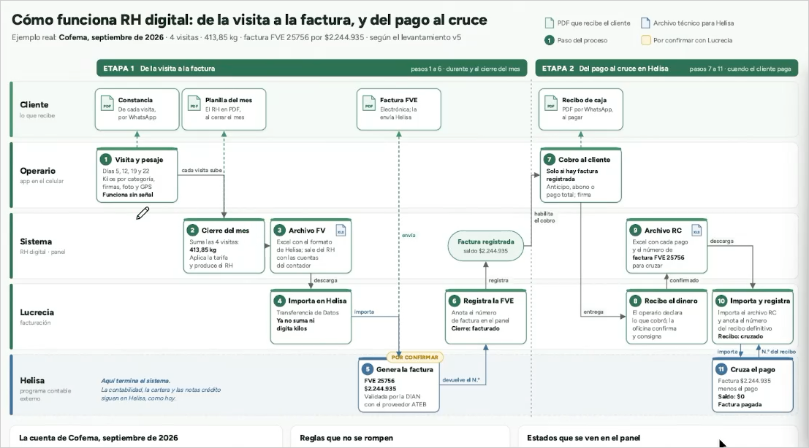

**Figura 1 (03:25).** Flujo de la v5 compartido en la reunión, sin la columna de cámaras. El paso 5 («Genera la factura») estaba marcado «por confirmar».

## 4. Lo que mostró Julio en Helisa (≈ 16:10 – 26:30)

Antes de compartir pantalla, Julio explicó (≈ 08:00 – 15:45) que el flujo **está bien concebido**, pero que subir archivos y devolver datos genera ida y vuelta y más trabajo, y que **Helisa no importa facturas: importa pedidos**. Luego mostró el Helisa de Comserva: **versión 4.12.2.0**, publicada por **TSplus** en servidores de helisacloud.com, en una instalación desde la que Julio atiende unas 20 empresas. Para la importación de pedidos y el plano en Excel usó **otra empresa que él atiende**, porque Comserva no tiene habilitado el documento Pedido; en las capturas se taparon los datos de terceros.

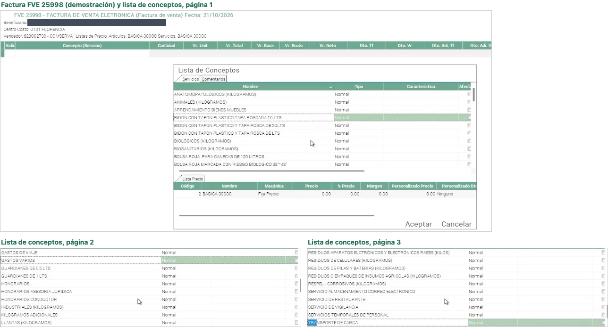

**Figura 2 (17:05 – 17:20).** Factura de demostración FVE 25998 en el Helisa de Comserva y su «Lista de conceptos»: conceptos por categoría en kilos (ANATOMOPATOLÓGICOS, ANIMALES, BIOLÓGICOS, BIOSANITARIOS, INDUSTRIALES…), «KILOGRAMOS ADICIONALES» y productos (bidones, bolsas, guardianes, arrendamiento). Lista de precios 2 «BASICA 30000». El cliente de la demostración está tapado. Al guardar, Helisa avisó que el concepto elegido no tenía cuentas de contabilización (17:30): las cuentas viven en cada concepto, no en la factura.

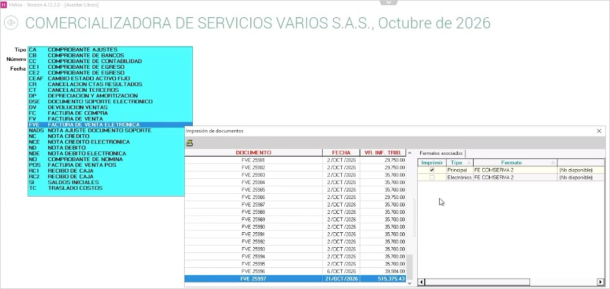

**Figura 3 (17:55 – 18:10).** Tipos de documento del Helisa de Comserva: FVE (factura de venta electrónica), FV (factura de venta, no electrónica), NCE, NDE, DSE y dos recibos de caja, **RC1 y RC2**. **No hay un tipo de pedido.** A la derecha, la impresión de documentos: FVE 25981 a 25995 del 2 de octubre por $29.750 o $35.700, FVE 25996 del 6 de octubre y FVE 25997 del 21 de octubre; formato «FE COMSERVA 2».

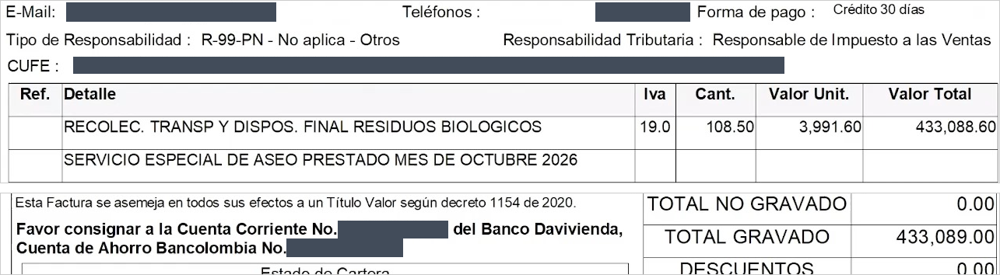

**Figura 4 (18:15).** Formato actual de la factura electrónica (FVE 25997). Cobra **solo por kilo**: 108,50 kg × $3.991,60 = $433.088,60, IVA 19 %, más la línea de comentario «Servicio especial de aseo prestado mes de octubre 2026»; forma de pago «Crédito 30 días». Se taparon el correo y el teléfono del cliente, el CUFE y los números de las cuentas bancarias.

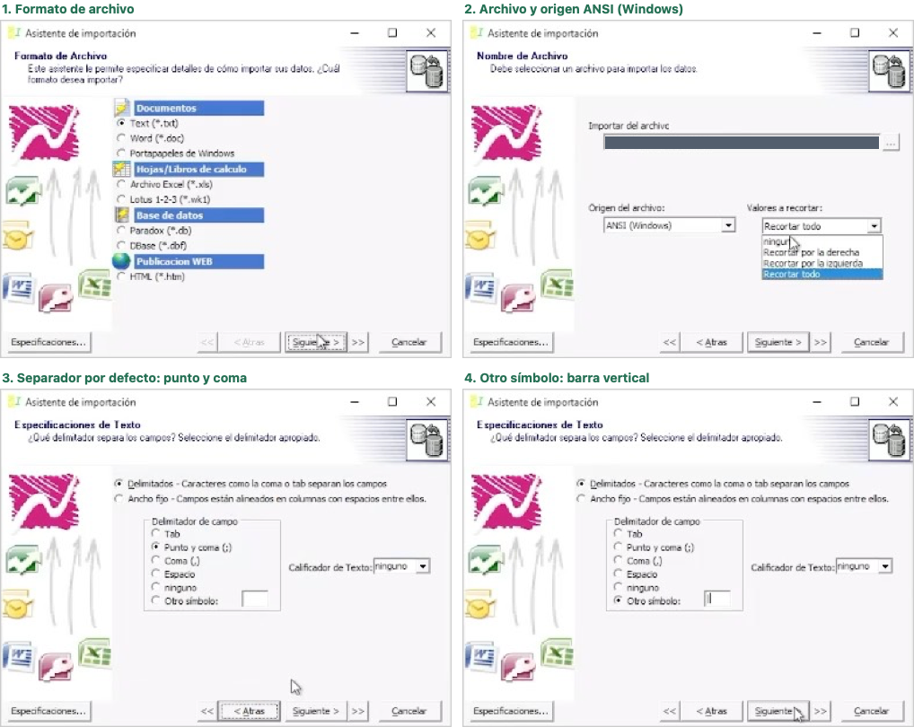

**Figura 5 (19:05 – 19:40, otra empresa).** Asistente de «Importación de pedidos»: acepta texto (.txt), Excel 97-2003 (.xls) y otros formatos; origen del archivo **ANSI (Windows)**; separador por defecto **punto y coma**, configurable (Julio escribe la barra vertical «|» en «Otro símbolo»); sin calificador de texto.

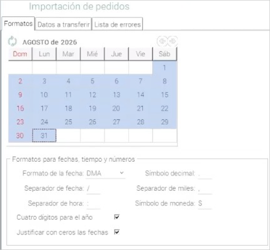

**Figura 6 (19:05, otra empresa).** Formatos de la importación de pedidos: fecha DMA con «/», cuatro dígitos para el año y ceros a la izquierda; símbolo decimal, separador de miles y símbolo de moneda configurables (en pantalla se leen «.», «,» y «$»; el que usará Comserva: por confirmar). El periodo se elige en el calendario.

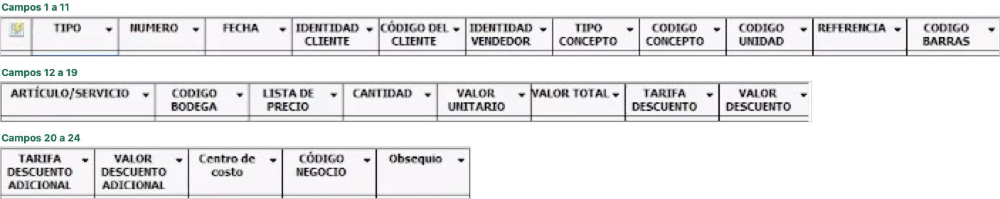

**Figura 7 (19:50 – 20:15, otra empresa).** Previsualización de un archivo de pedidos: **24 campos**, de TIPO a Obsequio. Solo se muestran los encabezados (las filas traían datos de pacientes de esa otra empresa). Julio (≈ 19:40): «el valor total no es obligatorio; como mínimo, la cantidad y el valor unitario»; cada línea es un concepto o un comentario, y en un mismo archivo caben todos los pedidos que se quiera.

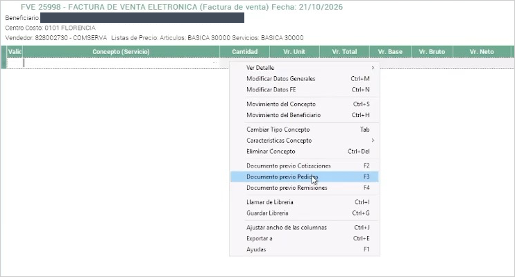

**Figura 8 (21:00 – 21:20).** De vuelta en Comserva: para facturar se abre una FVE, se elige el cliente y se llama el pedido con **«Documento previo Pedidos» (F3 en pantalla; en el audio se oye «F5»)**. Julio: «como no tengo habilitado pedidos, no me deja»; la factura se hace **una a una**, aunque se pueden llamar varios pedidos del mismo cliente en una factura.

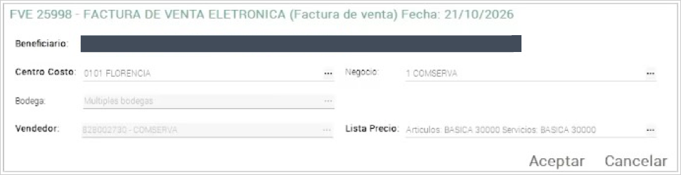

**Figura 9 (22:05).** Datos generales de la factura en Comserva: centro de costo **0101 FLORENCIA**, negocio **1 COMSERVA**, bodega «Múltiples bodegas», vendedor **828002730 – COMSERVA** y lista de precios **BASICA 30000**. Son los valores que llevaría cada pedido (por confirmar con Julio). Cliente tapado.

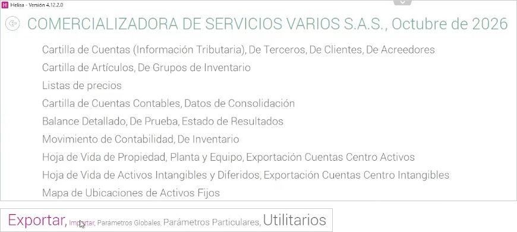

**Figura 10 (22:30).** Menú Exportar del Helisa de Comserva: cartillas de clientes, terceros, artículos y cuentas, listas de precios y movimiento de contabilidad. Sirve para la carga inicial del sistema (clientes con su código, conceptos, listas de precios).

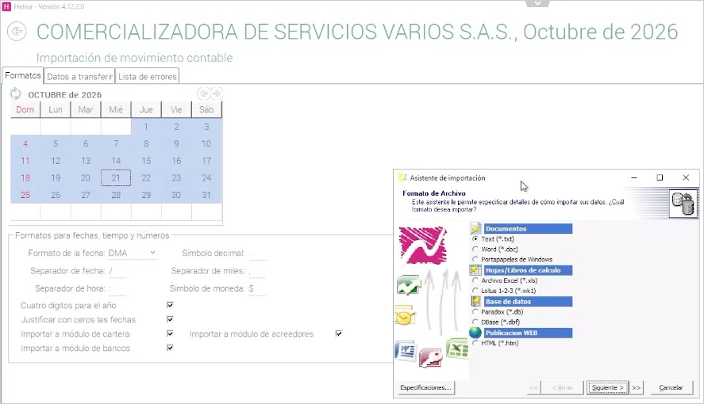

**Figura 11 (22:35 – 22:45).** «Importación de movimiento contable» en Comserva, la ruta del **recibo de caja**: periodo de uno o varios días, fecha DMA y casillas «Importar a módulo de cartera / de acreedores / de bancos». Julio (≈ 23:00): el recibo lleva la cuenta, el número del recibo, la identificación del cliente y, en una columna, **el prefijo y el número de la factura que se cruza**. No se mostró la estructura del recibo.

**Formato del TXT de pedidos (26:10 – 26:20, otra empresa).** Julio mostró el TXT de pedidos que arma desde Excel. No se incluye la captura, porque sus líneas eran servicios de salud de un paciente de esa otra empresa; el formato que se vio es este:

- **Sin fila de títulos:** el archivo empieza directamente con los datos.
- **Una línea por concepto o comentario**, con los **24 campos** de la figura 7 en ese orden, **separados por la barra vertical «|»**. Los campos vacíos quedan entre dos barras, así que cada línea lleva 23 barras.
- **Fecha dd/mm/aaaa.**
- TIPO CONCEPTO **2** para un servicio y **3** para una línea de comentario.
- La barra de estado del editor decía UTF-8, y en la previsualización de Helisa (que lee ANSI) las tildes salieron dañadas.

Ejemplo de una línea con datos de Cofema, septiembre de 2026 (**ejemplo elaborado por el equipo**, no es una captura; lo que va entre `< >` falta por confirmar con Julio):

    OP|1|23/09/2026|891190218|<código del cliente>|828002730|2|<código del concepto>||||KILOGRAMOS ADICIONALES||2|393.85|4600||||||0101||

## 5. Lo que se confirmó de la v5

1. **El flujo general está bien concebido** (≈ 08:00), con el matiz de que el ir y venir de archivos genera trabajo.
2. **La factura electrónica la sigue haciendo Helisa** desde la factura de venta y se envía a la DIAN **en línea o por lotes** (≈ 17:45).
3. **El recibo de caja sí se importa como movimiento contable** (22:20), con pocas cuentas: **1305 cartera contra caja o bancos** (≈ 10:40), y una columna con el prefijo y el número de la factura que se cruza (≈ 23:00).
4. **Helisa lleva dos libros**, contable y tributario, con planes de cuenta equivalentes; el archivo del recibo debe tenerlo en cuenta (≈ 11:00).
5. Los archivos pueden ser **Excel, .txt o .csv**, con **separador configurable**, y un archivo puede llevar **muchos documentos** (19:05 – 20:05).
6. **El número FVE lo asigna Helisa** al elaborar la factura.
7. **La contabilidad, la cartera y el cruce siguen en Helisa** (≈ 15:00).
8. La plantilla de 22 columnas de la v5 (espejo del CSV de movimiento contable) **sigue sirviendo para el recibo**.

## 6. Lo que cambió frente a la v5

| # | La v5 decía | La reunión mostró | Consecuencia para la v6 |
| --- | --- | --- | --- |
| 1 | Del RH sale un archivo que Helisa importa para generar la factura electrónica | **Helisa no importa facturas; importa pedidos** (≈ 09:00) | La salida hacia Helisa es un **archivo de pedidos (OP)**, no un archivo de factura |
| 2 | Un archivo con varios RH genera las facturas | La factura se hace **una a una**: se abre cada FVE y se llama el pedido con F3 (21:00 – 22:00) | Lucrecia sigue elaborando cada factura en Helisa (Propuesta 1) |
| 3 | El archivo de factura lleva cuentas, IVA, base y cuadre débito = crédito | **El pedido no lleva cuentas ni IVA**; el valor total no es obligatorio; Helisa calcula el IVA y contabiliza por concepto y forma de pago (≈ 12:00, 19:40, 24:00) | El pedido lleva cliente, concepto, cantidad y valor unitario; el IVA del RH queda como referencia |
| 4 | Plantilla inicial de 22 columnas | Pedido de **24 campos** (TIPO … Obsequio), TXT con «\|», sin títulos, fecha dd/mm/aaaa; el asistente lee **ANSI** | Escribir el archivo en Windows-1252 (ANSI) o sin tildes; la estructura oficial de Comserva está pendiente |
| 5 | Sin prerrequisitos en Helisa | **Comserva no tiene habilitado el documento Pedido** (21:15) | Prerrequisito nuevo: habilitarlo (costo o licencia por confirmar) |
| 6 | El NIT identifica al cliente | Un mismo NIT puede estar creado varias veces en Helisa con un **código adicional del cliente** (por ejemplo, sedes que se facturan aparte) (≈ 24:55) | El sistema guarda el código del cliente en Helisa por sede facturable |
| 7 | Fase 1 solo con «básico + kilos incluidos + adicional» | La FVE 25997 cobra **solo por kilo** y muchas FVE de octubre valen $29.750 o $35.700 (≈ $25.000 o $30.000 + IVA: cobro fijo, **inferencia**) | La fase 1 debe cubrir tres esquemas de tarifa |
| 8 | ≈ 12 facturas al mes | El consecutivo pasó de FVE 25756 (23 sep) a FVE 25997 (21 oct): **≈ 240 facturas en 4 semanas** (**inferencia**; incluye todo lo que factura Comserva; por confirmar) | Pesa en la decisión entre facturar una a una (P1) o que el sistema facture (P2) |
| 9 | Un tipo de recibo «RC» | Hay **RC1 y RC2** (17:55) | Cuál se usa: por confirmar |
| 10 | Helisa 4.10.3.0, instalación local | **Helisa 4.12.2.0 por TSplus** (helisacloud.com) | El archivo se sube a la sesión remota; una API se conectaría a ese servidor |
| 11 | Camilo (soporte de Helisa) enviaría la estructura | **Julio** enviará la estructura del pedido y del recibo en Excel y la plantilla «servicio → cuenta» | Julio es el interlocutor para formatos y cuentas |
| 12 | Conexión en línea con Helisa descartada | **Helisa Conekta** (API) vuelve como opción, con costo que Comserva asumiría (≈ 14:10, 27:30; **por confirmar por escrito**) | Modalidad 1B opcional: inserta pedidos y recibos y lee facturas y cartera, pero **no emite facturas** |
| 13 | La factura electrónica siempre la emite Helisa | Julio: «lo mejor es que ustedes pudieran hacer la facturación electrónica» (29:52) | **Propuesta 2**: el sistema factura por medio de un proveedor tecnológico |

## 7. Lo que quedó abierto

| Tema | Qué falta | Quién |
| --- | --- | --- |
| Documento Pedido | Habilitarlo en el Helisa de Comserva: costo, licencia, código del tipo (¿«OP»?) y quién lo hace | Julio / Comserva |
| Estructura oficial del pedido | Campo por campo: obligatorios, longitudes, separador, codificación, decimales, número del pedido | Julio |
| Estructura oficial del recibo | Columnas, columna de cruce, RC1 o RC2, cómo van los dos libros | Julio |
| Conceptos y listas de precios | Códigos de los conceptos que se facturan; lista de precios por cliente | Julio |
| Clientes | Cartilla de clientes con NIT, código y códigos adicionales por sede | Julio / Lucrecia |
| Cuentas | Caja, bancos y cartera 1305 en los dos libros; plantilla «servicio → cuenta» (para la P2) | Julio |
| Volumen y esquemas | Cuántas facturas al mes son de residuos; cuántos clientes pagan por kilo, fijo o básico + kilos | Comserva |
| Helisa Conekta | Confirmación por escrito de que Comserva paga la suscripción ($211.680 al mes según helisa.com; IVA y hosting por confirmar) | Comserva |
| Facturación electrónica (P2) | Proveedor preferido; plan actual de FE con Helisa (documentos y costo); qué se seguiría facturando en Helisa | Comserva / Julio |
| «Factura en sitio» | Qué quiso decir Julio (29:58): ¿factura por visita en lugar de mensual? Su alcance está por confirmar | Julio |
| Decisores | Quiénes son «la gerente» y «el ingeniero Ballesteros» y cuándo sería la socialización | Comserva |
| Personas | Si Lucrecia estuvo en la reunión; rol formal de Julio | Comserva |
| Unión Temporal Comserva | Si factura algún contrato de recolección | Comserva |

## 8. Acuerdos y compromisos

| # | Compromiso | Responsable | Fecha | Minuto |
| --- | --- | --- | --- | --- |
| 1 | Enviar la estructura del pedido y del recibo (archivo Excel) | Julio, por medio de Emerson o Ronaldo | Sin fecha; se le pide antes del viernes 23 de octubre | ≈ 15:45 |
| 2 | Suministrar la plantilla de cuentas «este servicio va con esta cuenta» | Julio | Sin fecha | 29:16 |
| 3 | Presentar **dos propuestas**: archivo para Helisa y facturación electrónica desde el sistema | Equipo RH digital | Para la reunión del viernes 23 de octubre | 31:53, 34:15 |
| 4 | Reunión de cierre para aterrizar las dos propuestas (≈ 30 minutos) | Comserva, Julio y equipo RH digital | **Viernes 23 de octubre de 2026, 1:00 p. m.** | 35:22 – 36:08 |
| 5 | Entregar la propuesta económica consolidada | Equipo RH digital | Después del viernes 23 de octubre (fecha por confirmar) | 32:35 – 32:45 |
| 6 | Socializar las propuestas con quien decide («la gerente» o «el ingeniero Ballesteros»), con apoyo de Julio para mostrar el ahorro | Comserva (logística), con Julio | Después de la propuesta económica (por confirmar) | 33:44 – 35:19 |

**Opinión expresada al cierre** (32:48 – 33:44): la persona de logística dijo que la opción de generar el archivo para Helisa le parece **«más viable en alcance y costos»**, pero pidió las dos propuestas para evaluarlas, y añadió que la decisión la toma quien dirige la empresa.

## 9. Siguientes pasos

1. **Jueves 22 de octubre:** enviar a Julio la solicitud formal de formatos (texto listo en `Preguntas y solicitudes para el viernes (23 oct 2026).md`, en esta carpeta).
2. **Jueves 22 de octubre:** preparar la v6 con las dos propuestas (comparativo, levantamientos, flujos y mockups de cada una).
3. **Viernes 23 de octubre, 1:00 p. m.:** reunión de cierre de 30 minutos con el orden del día y las preguntas de prioridad A.
4. **Después del viernes:** propuesta económica y, luego, reunión de socialización con quien decide.
5. **Si Comserva aprueba:** Fase 0 (definición): habilitar Pedido, recibir los formatos oficiales, armar la tabla de equivalencias y las cuentas, cargar la cartilla de clientes y hacer una importación de prueba con Cofema de septiembre.

**Cómo se llaman las propuestas en la v6**

- **Propuesta 1 · RH digital hasta Helisa:** el sistema genera los pedidos y los recibos para Helisa; Lucrecia elabora cada factura en Helisa llamando el pedido. Modalidad **1A** con archivos planos; modalidad **1B** con la API Helisa Conekta (opcional, la paga Comserva).
- **Propuesta 2 · RH digital con facturación electrónica:** el sistema emite la factura electrónica por medio de un proveedor tecnológico autorizado por la DIAN; Helisa queda para la contabilidad.
- **Fases:** Fase 0 · definición; Fase 1 · núcleo hasta Helisa (= Propuesta 1); Fase 2 · facturación electrónica (solo en la Propuesta 2). El equipo recomienda hacer la Fase 1 con un piloto de un ciclo y decidir la Fase 2 con lo que se mida en el piloto.
- **Complementos:** lo que en la v5 eran la fase 2 (acta y portal) y la fase 3 (caja formal y mensajería) pasan a ser **C1 · Acta y portal** y **C2 · Caja formal y mensajería**, que se pueden contratar después en cualquiera de las dos propuestas.

## 10. Fuentes

- Grabación de la reunión (37:57) y transcripción unida en `Transcripción reunión 21 oct 2026.txt` (TurboScribe de 02:20 a 32:20 y Whisper de 29:00 a 36:44).
- Capturas en `imagenes/`: recortadas sin caras y con los datos de terceros tapados con rectángulos sólidos. La del TXT de pedidos de la otra empresa no se incluye; su formato se describe con palabras en la sección 4.
- Precio de Helisa Conekta: página del producto en helisa.com, consultada el 22 de octubre de 2026 (https://helisa.com/producto/helisa-conekta/).
- Levantamiento v5 y flujo de la v5 (carpetas `levantamiento requerimientos/` y `reunion/`).
